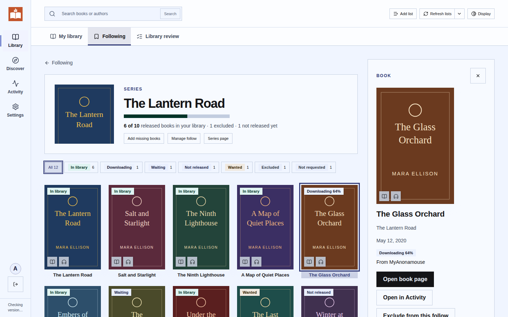
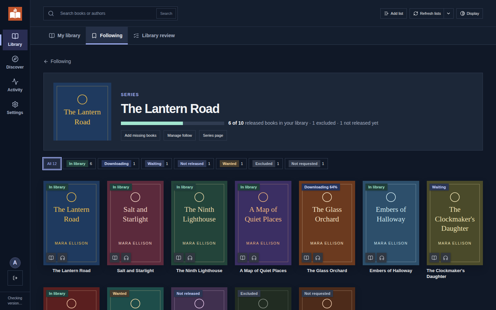
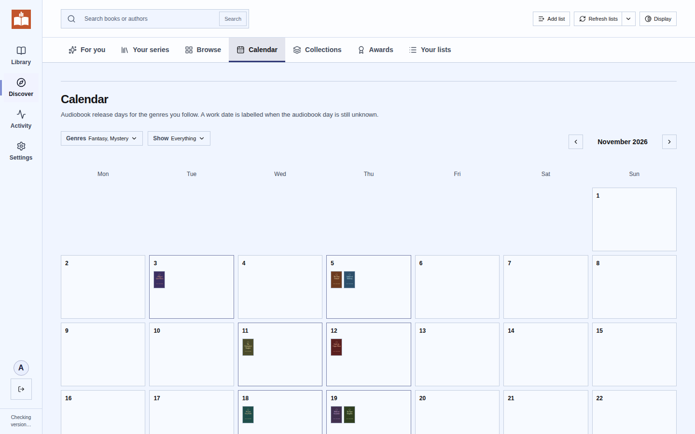
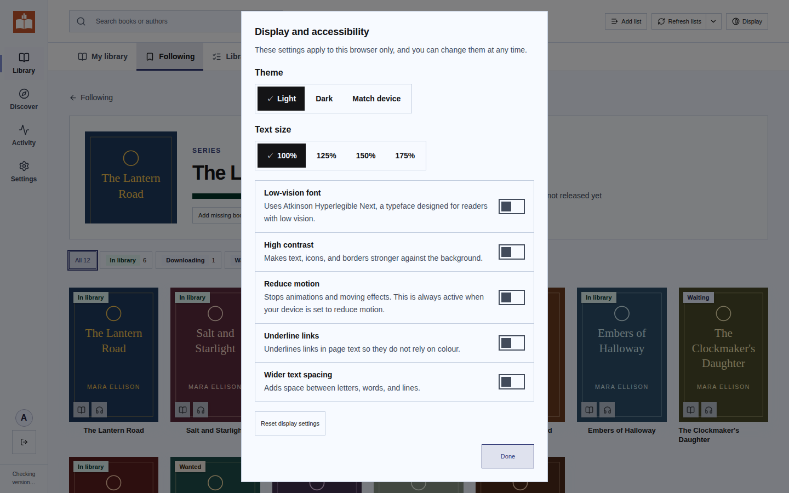
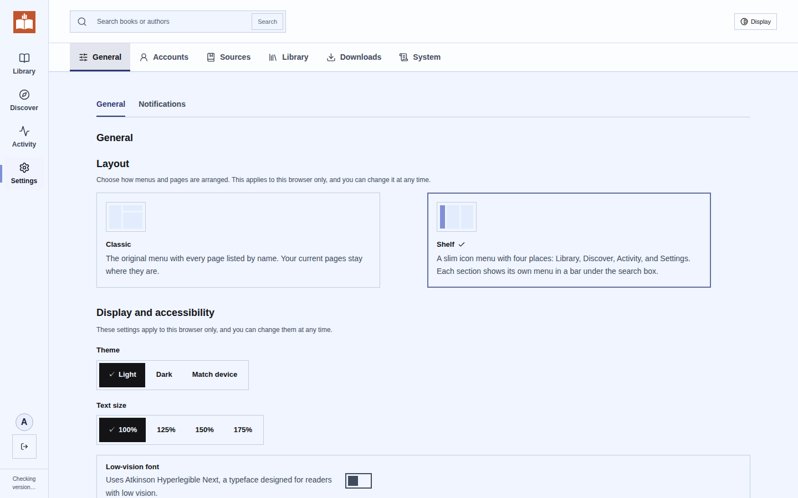
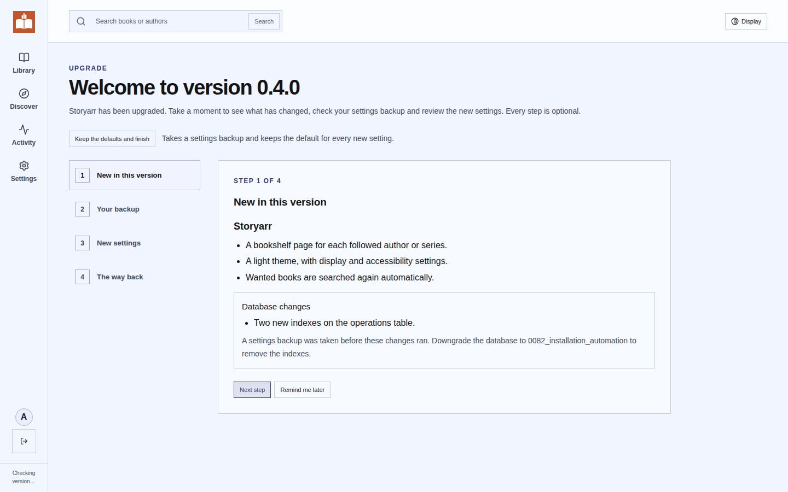

<p align="center"></p>
<h1 align="center">Storyarr</h1>
<p align="center">Follow authors and series, and keep your audiobook library complete.</p>



Storyarr connects your reading lists, your audiobook library and your download clients. Follow an author or a
series, and the books you are missing are found, downloaded and imported into Audiobookshelf or Grimmory.

Storyarr is a fork of [Dewarr](https://github.com/logabell/dewarr) by logabell, released under the same MIT
licence.

## What Storyarr adds to Dewarr

- **Bookshelf pages** for each followed author or series: a cover wall with a status on every book, a progress
  bar and a side panel with Search now and Exclude.
- **One status for every followed book:** In library, Downloading, Waiting (with the next search time), Not
  released, Wanted, Excluded with the reason, and more.
- **Smarter searching:** wanted books are searched again automatically, and **Add missing books** fills gaps in a
  series in one step.
- **A light theme and accessibility settings:** text size up to 175%, a low-vision font, high contrast,
  reduced motion, underlined links and wider spacing. WCAG 2.2 AA contrast in every theme.
- **Two layouts:** Classic, or Shelf with a slim icon menu.
- **Safe upgrades:** a settings backup before every upgrade, a wizard that explains each change, and a way
  back. Automatic upgrades if you prefer.
- **Speed:** request counts that took minutes on large libraries now take under a second.

The full list is in the [changelog](CHANGELOG.md).

## Everything from Dewarr

- **Library integration** — connect Audiobookshelf or Grimmory, see what you own, and import completed downloads into verified library folders.
- **Chapterized M4B** — merge a multi-file MP3 download into one audiobook, with a chapter per file, before library import. The download itself stays unchanged.
- **Goodreads sync** — follow shelves, import CSV exports, and check for new books automatically.
- **Author and series follows** — monitor future books with reviewed back-catalog selection, filters, exclusions, and release-day acquisition.
- **Hardcover sync** — track your lists and lists you follow, including private lists your account can access.
- **Custom Goodreads lists** — add public lists, track changes, and pin them to your discovery page.
- **For you** — personalize shelves with followed lists, recommendations, trending books, and new releases.
- **Auto download** — find and select eligible releases using list policies and approved import routes.
- **Download priorities** — rank sources and formats, apply size and seed preferences, and control download capacity.
- **Book discovery** — browse collections, awards, authors, and series.
- **Download sources** — connect MyAnonamouse, Prowlarr, and AudiobookBay; send transfers to qBittorrent.
- **Notifications** — personal and installation alerts through Discord, ntfy, Apprise, and JSON webhooks, with discovery digests. [Setup and payload documentation](docs/NOTIFICATIONS.md).
- **Shared library** — individual accounts, reading lists, permissions, and download activity.
- **Self-hosted** — Docker, PostgreSQL, and an MIT license.

Early release. Automatic downloads are off by default. Goodreads RSS imports can be partial; CSV import fills historical gaps. See [reading accounts](docs/READING-ACCOUNTS.md) for sync behavior.

## Quick start

Save [`compose.yaml`](compose.yaml), set both `change-me` passwords to the same value, then:

```sh
mkdir -p config data
docker compose up -d
```

Open [localhost:8000](http://localhost:8000) and create the first account. Images are published for amd64 and
arm64 at `ghcr.io/themightytrex/storyarr`.

- [Installing](docs/INSTALL.md): Compose, `docker run`, image tags and the settings you can add.
- [Setting up](docs/SETUP.md): the setup steps, Hardcover tokens, folders and following your first series.
- [Updating](docs/UPDATING.md): how updates reach you, the upgrade wizard, automatic upgrades and going back.
- [Moving from Dewarr](docs/MIGRATING.md): switch images and keep your database. Tested both ways.

More: [Docker settings and backups](docs/DOCKER.md) · [Metadata sources](docs/METADATA-SOURCES.md) ·
[Download clients](docs/DOWNLOAD-CLIENTS.md) · [MAM proxy](docs/MAM-PROXY.md) ·
[Request quotas](docs/REQUEST-QUOTAS.md) · [Notifications](docs/NOTIFICATIONS.md) ·
[Contributing](docs/DEVELOPMENT.md) · [Releasing](docs/RELEASING.md)

## Screenshots

The books and covers below are invented for the screenshots.

### Bookshelf, in the dark theme


### Release calendar


### Display and accessibility


### Settings


### Upgrade wizard


## Updates

```sh
docker compose pull
docker compose up -d
```

Back up `config` and PostgreSQL first. Storyarr saves a settings backup and runs database migrations on its own,
then shows admins what changed. [Updating](docs/UPDATING.md) has the details.

## Contributors

Storyarr is maintained by [TheMightyTRexUK](https://github.com/TheMightyTRex), building on Dewarr by
[logabell](https://github.com/logabell) and its contributors.

Thanks to [@Porthorion](https://github.com/Porthorion) for contributing AudiobookBay fixes through [#42](https://github.com/logabell/dewarr/pull/42), [#43](https://github.com/logabell/dewarr/pull/43), and [#44](https://github.com/logabell/dewarr/pull/44): retrying capitalized searches, matching series-numbered releases, and linking completed downloads to their catalog books. Their changes were adapted with additional identity safeguards in [16879ba](https://github.com/logabell/dewarr/commit/16879bac26137d6e9548ecefd0532a0d544c2dc2) and shipped in [v0.3.5](https://github.com/logabell/dewarr/releases/tag/v0.3.5).

See also [all commit contributors](https://github.com/logabell/dewarr/graphs/contributors) and the contributor acknowledgments in [Dewarr's release notes](https://github.com/logabell/dewarr/releases).

## License

[MIT](LICENSE). Third-party libraries and assets retain their own licenses; see [notices](docs/notices/).
